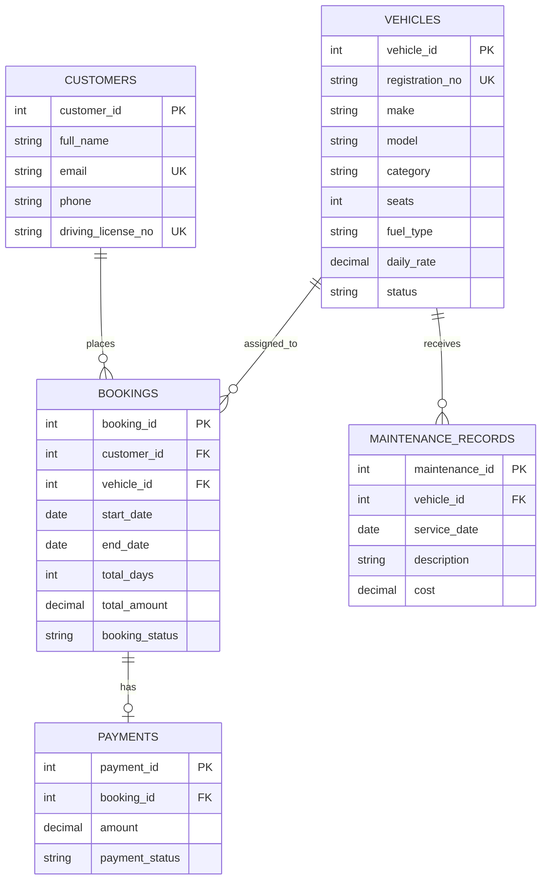

# ER Diagram — Vehicle Rental Management System

A customer can make multiple bookings; a vehicle can be booked many times over time. Each booking can have one payment record, and a vehicle can have multiple maintenance records.
